### 介绍
本文使用bilibili的直播流（也有部分mp4）为实例进行结构说明，其并不包含全部mp4结构类型。

### fmp4结构
#### Box
Box是mp4的基础结构单元

```
+---------+-------+
|Box      |       |
+---------+-------+
|BoxHeader|BoxData|
+---------+-------+
```

```
+---------+------+---------+
|BoxHeader|      |         |
+---------+------+---------+
|size     |type  |largeSize|
+---------+------+---------+
|4bytes   |4bytes|8bytes   |
+---------+------+---------+
```

<code hidden>
BoxHeader
size,type,largeSize
4bytes,4bytes,8bytes
</code>

当`size==1`时，才有`largeSize`

### mp4总体结构
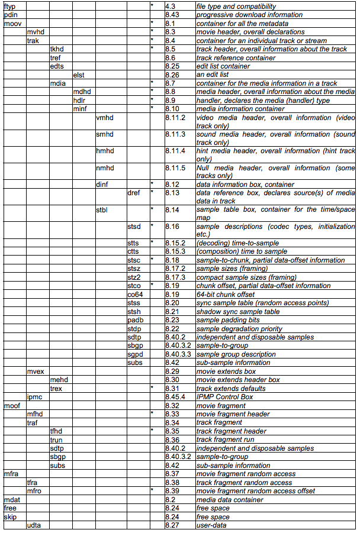

### ftyp
通常放在MP4文件的开头，告诉解码器基本的解码版本和兼容格式。

```
+--------+------+-----------+-------------+-----------------+
|ftyp Box|      |           |             |                 |
+--------+------+-----------+-------------+-----------------+
|size    |type  |major_brand|minor_version|compatible_brands|
+--------+------+-----------+-------------+-----------------+
|4bytes  |"ftyp"|4bytes     |4bytes       |4bytes/per       |
+--------+------+-----------+-------------+-----------------+
```

- major_brand:推荐兼容性的版本
- minor_version:最低兼容性的版本
- compatible_brands:所有的兼容性的版本

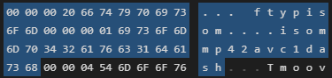

### moov
作为容器盒子，存放相关的trak及meta信息。

```
+--------+------+----+
|moov Box|      |    |
+--------+------+----+
|size    |type  |Boxs|
+--------+------+----+
|4bytes  |"moov"|Boxs|
+--------+------+----+
```

- Boxs:其他的box

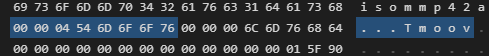

#### mvhd
mvhd 是 moov 下的第一个 box，用来描述 media 的相关信息。

```
+--------+------+-------+-------------+-----------------+---------+--------+----------+------+---------+--------+-------------+
|mvhd Box|      |       |             |                 |         |        |          |      |         |        |             |
+--------+------+-------+-------------+-----------------+---------+--------+----------+------+---------+--------+-------------+
|size    |type  |version|creation_time|modification_time|timescale|duration|rate      |volume|reserved |matrixs |next_track_ID|
+--------+------+-------+-------------+-----------------+---------+--------+----------+------+---------+--------+-------------+
|4bytes  |"mvhd"|4bytes |4bytes       |4bytes           |4bytes   |4bytes  |0x00010000|2bytes|10bytes*0|9*4bytes|4bytes       |
+--------+------+-------+-------------+-----------------+---------+--------+----------+------+---------+--------+-------------+
```

- version:版本
- creation_time:创建的UTC时间
- modification_time:最后一次修改时间
- timescale:1秒时间内的刻度值
- duration:该track的时间长度(duration/timescale = xx 秒)
- rate:推荐播放速率
- volume:音量大小(0x0100 为最大值)
- reserved:保留字段(0)
- matrixs:视频变换矩阵
- next_track_ID:下一个track使用的id号

实例：

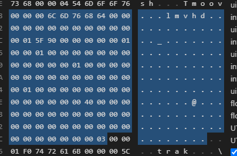

```
[mvhd] Size=108 Version=0 Flags=0x000000 CreationTimeV0=0 ModificationTimeV0=0 Timescale=90000 DurationV0=0 Rate=1 Volume=256 Matrix=[0x10000, 0x0, 0x0, 0x0, 0x10000, 0x0, 0x0, 0x0, 0x40000000] PreDefined=[0, 0, 0, 0, 0, 0] NextTrackID=3
```

#### trak
trak box 就是主要存放相关 media stream 的内容，容器盒子。

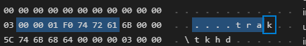

音频相关：

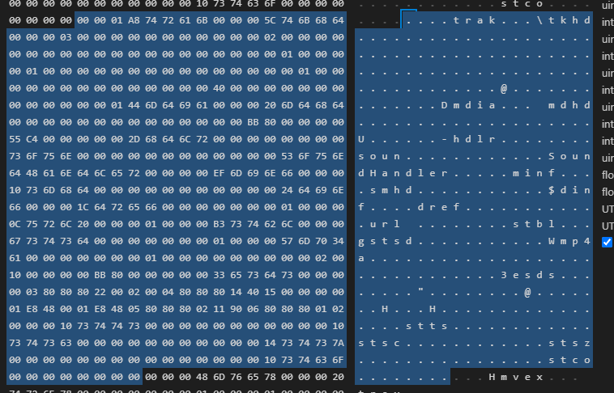

#### tkhd
tkhd 是 trak box 的子一级 box 的内容。主要是用来描述该特定 trak 的相关内容信息。

```
+--------+------+-------+-------------+-------------+-----------------+--------+--------+--------+----------+--------+------+---------------+------+--------+--------+------+------+
|tkhd Box|      |       |             |             |                 |        |        |        |          |        |      |               |      |        |        |      |      |
+--------+------+-------+-------------+-------------+-----------------+--------+--------+--------+----------+--------+------+---------------+------+--------+--------+------+------+
|size    |type  |version|flag         |creation_time|modification_time|track_ID|reserved|duration|reserved  |reserved|layer |alternate_group|volume|reserved|matrix  |width |height|
+--------+------+-------+-------------+-------------+-----------------+--------+--------+--------+----------+--------+------+---------------+------+--------+--------+------+------+
|4bytes  |"tkhd"|1bytes |3bytes       |4bytes       |4bytes           |4bytes  |4bytes*0|4bytes  |4*2bytes*0|2bytes*0|2bytes|2bytes         |2bytes|2bytes*0|4*9bytes|4bytes|4bytes|
+--------+------+-------+-------------+-------------+-----------------+--------+--------+--------+----------+--------+------+---------------+------+--------+--------+------+------+
```

- flags：按位或操作获得。0x000001，表示这个track是启用的，当值为0x000000，表示这个track没有启用；值为0x000002，表示当前track在播放时会用到；值为0x000004，表示当前track用于预览模式；
- layer:图层
- alternate_group:备用分组ID
- volume:当是音频帧时，为`0x0100`否则为`0`
- matrix:`0x00010000,0,0,0,0x00010000,0,0,0,0x40000000`

实例：

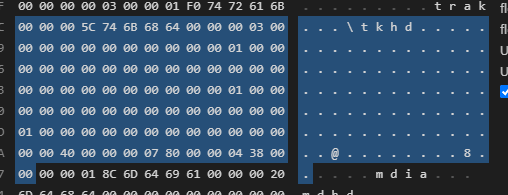

```
[tkhd] Size=92 Version=0 Flags=0x000003 CreationTimeV0=0 ModificationTimeV0=0 TrackID=1 DurationV0=0 Layer=0 AlternateGroup=0 Volume=0 Matrix=[0x10000, 0x0, 0x0, 0x0, 0x10000, 0x0, 0x0, 0x0, 0x40000000] Width=1920 Height=1080
```

#### mdia
mdia 主要用来包裹相关的 media 信息，容器盒子。

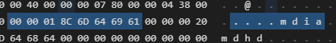

#### mdhd
Media Header Box

```
+--------+------+-------+-------------+-----------------+---------+--------+------+--------+
|mdhd Box|      |       |             |                 |         |        |      |        |
+--------+------+-------+-------------+-----------------+---------+--------+------+--------+
|size    |type  |version|creation_time|modification_time|timescale|duration|pad   |language|
+--------+------+-------+-------------+-----------------+---------+--------+------+--------+
|4bytes  |"mdhd"|4bytes |4bytes       |4bytes           |4bytes   |4bytes  |1bit*0|5*3bit  |
+--------+------+-------+-------------+-----------------+---------+--------+------+--------+
```

实例：

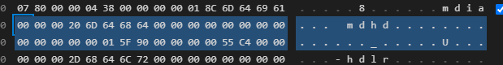

```
[mdhd] Size=32 Version=0 Flags=0x000000 CreationTimeV0=0 ModificationTimeV0=0 Timescale=48000 DurationV0=0 Language="und" PreDefined=0
```

#### hdlr
媒体处理器声明

```
+--------+------+-------+-----------+------------+----------+--------------------------------+
|hdlr Box|      |       |           |            |          |                                |
+--------+------+-------+-----------+------------+----------+--------------------------------+
|size    |type  |version|pre_defined|handler_type|reserved  |data                            |
+--------+------+-------+-----------+------------+----------+--------------------------------+
|4bytes  |"hdlr"|4bytes |4bytes     |4bytes      |4*3bytes*0|"VideoHandler" or "SoundHandler"|
+--------+------+-------+-----------+------------+----------+--------------------------------+
```

- handler_type:类型
```
vide : Video track
soun : Audio track
hint : Hint track
meta : Timed Metadata track
auxv : Auxiliary Video track
```


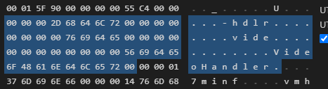

#### minf
媒体信息容器，当前 track 的基本描述信息，容器盒子。

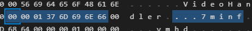

#### vmhd
Video Media Header Box，只有视频帧才存在。

```
+--------+------+-------+------------+----------+
|vmhd Box|      |       |            |          |
+--------+------+-------+------------+----------+
|size    |type  |version|graphicsmode|opcolor   |
+--------+------+-------+------------+----------+
|4bytes  |"vmhd"|4bytes |2bytes*0    |2*3bytes*0|
+--------+------+-------+------------+----------+
```

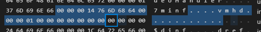

#### dinf
Data Information Box，容器盒子。

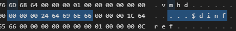

#### dref
设置当前Box描述信息的 data_entry。

```
+--------+------+--------+-----------+-------------+------+-----------+
|dref Box|      |        |           |             |      |           |
+--------+------+--------+-----------+-------------+------+-----------+
|size    |type  |version |entry_count|entry_version|'url '|entry_flags|
+--------+------+--------+-----------+-------------+------+-----------+
|4bytes  |"dref"|4bytes*0|4bytes     |4bytes       |'url '|3bytes     |
+--------+------+--------+-----------+-------------+------+-----------+
```

- entry_count:从1递增

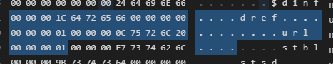

#### stbl
采样表，容器盒子。

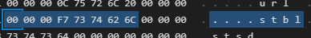

#### stsd
采样描述。

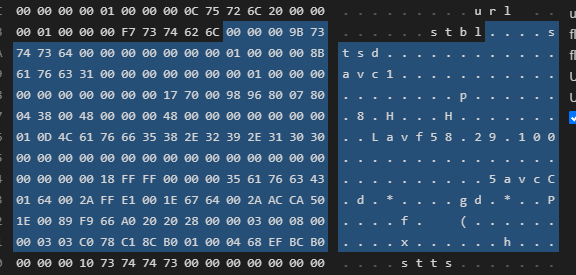

#### stts
描述simple的dts，使用dts间隔(sampleDelta)(时长)
```
+-----------+-----------+-------+------+----------+--------+
|stts Box   |           |       |      |          |        |
+-----------+-----------+-------+------+----------+--------+
|size       |type       |version|flags |entryCount|[option]|
+-----------+-----------+-------+------+----------+--------+
|4bytes     |'stts'     |1byte  |3bytes|4bytes    |[]      |
+-----------+-----------+-------+------+----------+--------+
|option     |           |       |      |          |        |
+-----------+-----------+-------+------+----------+--------+
|sampleCount|sampleDelta|       |      |          |        |
+-----------+-----------+-------+------+----------+--------+
|4bytes/per |4bytes/per |       |      |          |        |
+-----------+-----------+-------+------+----------+--------+
```

<code hidden>
stts Box
size,type,version,flags,entryCount,[option]
4bytes,'stts',1byte,3bytes,4bytes,[]
option
sampleCount,sampleDelta
4bytes/per,4bytes/per
</code>

```
entryCount: sampleCount、sampleDelta对总数
sampleCount: sample数量(相同sampleDelta)
sampleDelta: dts间隔

不同sampleDelta再起新的sampleCount、sampleDelta
```
实例：
```
[stts] size=6744 version=0 flags=000000
  - sampleCount: 841
  - entry[1]: sampleCount=1 sampleDelta=2880
  - entry[2]: sampleCount=1 sampleDelta=3060
  - entry[3]: sampleCount=2 sampleDelta=2970
  - entry[4]: sampleCount=1 sampleDelta=3060
    ...
```

在fmp4中，将不会有内容

#### stsz
描述了每个simple的size

```
+----------+------+-------+------+----------+--------+
|stsz Box  |      |       |      |          |        |
+----------+------+-------+------+----------+--------+
|size      |type  |version|flags |entryCount|[option]|
+----------+------+-------+------+----------+--------+
|4bytes    |'stsz'|1byte  |3bytes|8bytes    |[]      |
+----------+------+-------+------+----------+--------+
|option    |      |       |      |          |        |
+----------+------+-------+------+----------+--------+
|size      |      |       |      |          |        |
+----------+------+-------+------+----------+--------+
|4bytes/per|      |       |      |          |        |
+----------+------+-------+------+----------+--------+

```

<code hidden>
stsz Box
size,type,version,flags,entryCount,[option]
4bytes,'stsz',1byte,3bytes,8bytes,[]
option
size
4bytes/per
</code>

实例：
```
[stsz] size=5060 version=0 flags=000000
  - sampleCount: 1260
  - sample[1] size=202816
  - sample[2] size=14361
  - sample[3] size=14366
  ...
```

在fmp4中，将不会有内容

#### stsc
描述了chunk中有多少simple

```
+----------+---------------+-------------------+------+----------+--------+
|stsc Box  |               |                   |      |          |        |
+----------+---------------+-------------------+------+----------+--------+
|size      |type           |version            |flags |entryCount|[option]|
+----------+---------------+-------------------+------+----------+--------+
|4bytes    |'stsc'         |1byte              |3bytes|4bytes    |[]      |
+----------+---------------+-------------------+------+----------+--------+
|option    |               |                   |      |          |        |
+----------+---------------+-------------------+------+----------+--------+
|firstChunk|samplesPerChunk|sampleDescriptionID|      |          |        |
+----------+---------------+-------------------+------+----------+--------+
|4bytes/per|4bytes/per     |4bytes/per         |      |          |        |
+----------+---------------+-------------------+------+----------+--------+
```

<code hidden>
stsc Box
size,type,version,flags,entryCount,[option]
4bytes,'stsc',1byte,3bytes,4bytes,[]
option
firstChunk,samplesPerChunk,sampleDescriptionID
4bytes/per,4bytes/per,4bytes/per
</code>

```
entryCount: firstChunk、samplesPerChunk、sampleDescriptionID对总数
firstChunk: 同数量samplesPerChunk开始索引
samplesPerChunk: 一个chunk有多少sample
sampleDescriptionID: 通常为1
```
实例：
```
[stsc] size=52 version=0 flags=000000
  - entryCount: 3
  - entry[1]: firstChunk=1 samplesPerChunk=1 sampleDescriptionID=1
  - entry[2]: firstChunk=720 samplesPerChunk=2 sampleDescriptionID=1
  - entry[3]: firstChunk=721 samplesPerChunk=1 sampleDescriptionID=1
```

在fmp4中，将不会有内容

#### stco
描述chunk的偏移量

```
+-----------+------+-------+------+----------+--------+
|stco Box   |      |       |      |          |        |
+-----------+------+-------+------+----------+--------+
|size       |type  |version|flags |entryCount|[option]|
+-----------+------+-------+------+----------+--------+
|4bytes     |'stco'|1byte  |3bytes|4bytes    |[]      |
+-----------+------+-------+------+----------+--------+
|option     |      |       |      |          |        |
+-----------+------+-------+------+----------+--------+
|chunkOffset|      |       |      |          |        |
+-----------+------+-------+------+----------+--------+
|4bytes/per |      |       |      |          |        |
+-----------+------+-------+------+----------+--------+
```

<code hidden>
stco Box
size,type,version,flags,entryCount,[option]
4bytes,'stco',1byte,3bytes,4bytes,[]
option
chunkOffset
4bytes/per
</code>

实例：
```
[stco] size=5052 version=0 flags=000000
  - entryCount: 1259
  - entry[1]: chunkOffset=255979
  - entry[2]: chunkOffset=271146
  ...
```

在fmp4中，将不会有内容

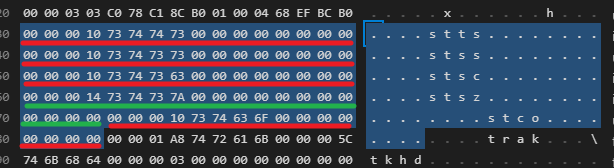

#### co64
描述chunk的偏移量，是`stco`的替代（当偏移量过大，4bytes无法容纳时）

```
+-----------+------+-------+------+----------+--------+
|co64 Box   |      |       |      |          |        |
+-----------+------+-------+------+----------+--------+
|size       |type  |version|flags |entryCount|[option]|
+-----------+------+-------+------+----------+--------+
|4bytes     |'co64'|1byte  |3bytes|4bytes    |[]      |
+-----------+------+-------+------+----------+--------+
|option     |      |       |      |          |        |
+-----------+------+-------+------+----------+--------+
|chunkOffset|      |       |      |          |        |
+-----------+------+-------+------+----------+--------+
|8bytes/per |      |       |      |          |        |
+-----------+------+-------+------+----------+--------+
```

<code hidden>
co64 Box
size,type,version,flags,entryCount,[option]
4bytes,'co64',1byte,3bytes,4bytes,[]
option
chunkOffset
8bytes/per
</code>

#### mvex
Movie Extend box，容器盒子。

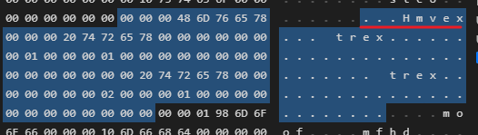

#### trex
Track Extends Box。

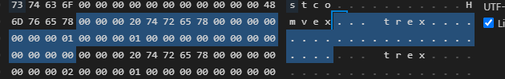

### moof
容器盒子。

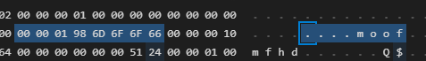

#### mfhd
trak默认设置。

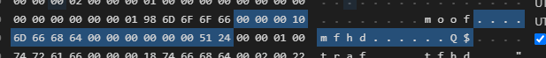

#### traf
容器盒子。

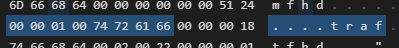

#### tfhd
指定trak默认设置

```
+-------+------+-------+-------+--------+------+
|tfhdBox|      |       |       |        |      |
+-------+------+-------+-------+--------+------+
|size   |type  |version|tr_flag|track_id|option|
+-------+------+-------+-------+--------+------+
|4bytes |"tfhd"|1byte  |3bytes |4bytes  |option|
+-------+------+-------+-------+--------+------+
```

- track_id:必须，其他都是可选
- tr_flag:使用或运算，表示后面存在什么可选值

tr_flag:使用或运算

- `0x000001`: 应用base_data_offset
- `0x000002`: 应用sample_description_index
- `0x000008`: 应用default_sample_duration
- `0x000010`: 应用default_sample_size
- `0x000020`: 应用default_sample_flags
- `0x010000`: duration‐is‐empty
- `0x020000`: default‐base‐is‐moof

```
+----------------+------------------------+-----------------------+-------------------+--------------------+
|option          |                        |                       |                   |                    |
+----------------+------------------------+-----------------------+-------------------+--------------------+
|base_data_offset|sample_description_index|default_sample_duration|default_sample_size|default_sample_flags|
+----------------+------------------------+-----------------------+-------------------+--------------------+
|8bytes          |4bytes                  |4bytes                 |4bytes             |4bytes              |
+----------------+------------------------+-----------------------+-------------------+--------------------+
```

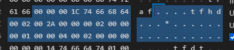

#### tfdt
sample编码绝对时间

```
+-------+------+-------+--------+-------------------+
|tfdtBox|      |       |        |                   |
+-------+------+-------+--------+-------------------+
|size   |type  |version|0       |baseMediaDecodeTime|
+-------+------+-------+--------+-------------------+
|4bytes |"tfdt"|0x00   |7bytes*0|4bytes             |
+-------+------+-------+--------+-------------------+
|size   |type  |version|0       |baseMediaDecodeTime|
+-------+------+-------+--------+-------------------+
|4bytes |"tfdt"|0x01   |3bytes*0|8bytes             |
+-------+------+-------+--------+-------------------+
```

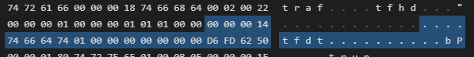

```
[tfdt] Size=20 Version=1 Flags=0x000000 BaseMediaDecodeTimeV1=3606930000
```

#### trun
sample相关内容。

```
+--------+------+-------+-------+------------+-----------+------------------+----------+
|trun box|      |       |       |            |           |                  |          |
+--------+------+-------+-------+------------+-----------+------------------+----------+
|size    |"trun"|version|tr_flag|sample_count|data_offset|first_sample_flags|[optional]|
+--------+------+-------+-------+------------+-----------+------------------+----------+
|4bytes  |"trun"|1byte  |3bytes |4bytes      |4bytes     |4bytes            |[]        |
+--------+------+-------+-------+------------+-----------+------------------+----------+
```

data_offset: 从`moof`Box的起始位置（boxSize第一个字节）到`mdat`中对应的sample数据块的第一个字节的偏移值

tr_flag:使用或运算

- `0x000001`: 应用data-offset
- `0x000004`: 应用first_sample_flags
- `0x000100`: sample使用自己的duration时长，若无，使用默认
- `0x000200`: sample使用自己的size长度，若无，使用默认
- `0x000400`: sample使用自己的flag，若无，使用默认
- `0x000800`: sample使用自己的stc，若无，使用默认

```
+---------------+-----------+------------+-----------------------------------+
|optional       |           |            |                                   |
+---------------+-----------+------------+-----------------------------------+
|sample_duration|sample_size|sample_flags|sample_composition_time_offset(cts)|
+---------------+-----------+------------+-----------------------------------+
|4bytes         |4bytes     |4bytes      |4bytes                             |
+---------------+-----------+------------+-----------------------------------+
```

```
+------------+-----------------+---------------------+---------------------+--------------------+---------------+---------------------------+
|sample_flags|                 |                     |                     |                    |               |                           |
+------------+-----------------+---------------------+---------------------+--------------------+---------------+---------------------------+
|reserved    |sample_depends_on|sample_is_depended_on|sample_has_redundancy|sample_padding_value|non_sync_sample|sample_degradation_priority|
+------------+-----------------+---------------------+---------------------+--------------------+---------------+---------------------------+
|6bits       |2bits            |2bits                |2bits                |3bits               |1bit           |16bits                     |
+------------+-----------------+---------------------+---------------------+--------------------+---------------+---------------------------+
```

sample_depends_on:

- 0: 未知
- 1: 非I帧
- 2: I帧
- 3: 保留

目前观察到的两种视频`sample_flags`

- `0x02000000`: I帧
- `0x01010000`: 非I帧

实例：

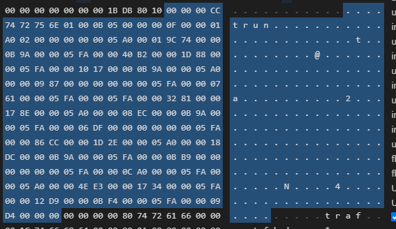

```
[trun] Size=204 Version=1 Flags=0x000b05 SampleCount=15 DataOffset=416 FirstSampleFlags=0x2000000 
Entries=[{SampleDuration=1440 SampleSize=105588 SampleCompositionTimeOffsetV1=2970}, 
{SampleDuration=1530 SampleSize=16562 SampleCompositionTimeOffsetV1=7560}, 
{SampleDuration=1530 SampleSize=4119 SampleCompositionTimeOffsetV1=2970}, 
{SampleDuration=1440 SampleSize=2439 SampleCompositionTimeOffsetV1=0}, 
{SampleDuration=1530 SampleSize=1889 SampleCompositionTimeOffsetV1=1530}, 
{SampleDuration=1530 SampleSize=12929 SampleCompositionTimeOffsetV1=6030}, 
{SampleDuration=1440 SampleSize=2284 SampleCompositionTimeOffsetV1=2970}, 
{SampleDuration=1530 SampleSize=1759 SampleCompositionTimeOffsetV1=0}, 
{SampleDuration=1530 SampleSize=34508 SampleCompositionTimeOffsetV1=7470}, 
{SampleDuration=1440 SampleSize=6364 SampleCompositionTimeOffsetV1=2970}, 
{SampleDuration=1530 SampleSize=3001 SampleCompositionTimeOffsetV1=0}, 
{SampleDuration=1530 SampleSize=3232 SampleCompositionTimeOffsetV1=1530}, 
{SampleDuration=1440 SampleSize=20195 SampleCompositionTimeOffsetV1=5940}, 
{SampleDuration=1530 SampleSize=4825 SampleCompositionTimeOffsetV1=3060}, 
{SampleDuration=1530 SampleSize=2516 SampleCompositionTimeOffsetV1=0}]
```

### mdat
sample，容器盒子。

对于普通的h264+acc流，其内容常见为多个AVCC视频NALU和ACC音频数据，各自的索引见`trun`的`data_offset`。

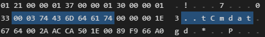

### 参考

- [音视频学习-FMP4结构之FMP4](https://lucius0.github.io/2018/01/16/archivers/media-study-08/)
- [mp4-container](https://www.ramugedia.com/mp4-container)
- [ISO/IEC 15444-12 MP4 封装格式标准摘录 4](https://www.cnblogs.com/gardenofhu/p/10040122.html)
- [5分钟入门MP4文件格式](https://www.cnblogs.com/chyingp/p/mp4-file-format.html)

### 本文图表生成

- [https://arthursonzogni.com/Diagon/#Table](https://arthursonzogni.com/Diagon/#Table)